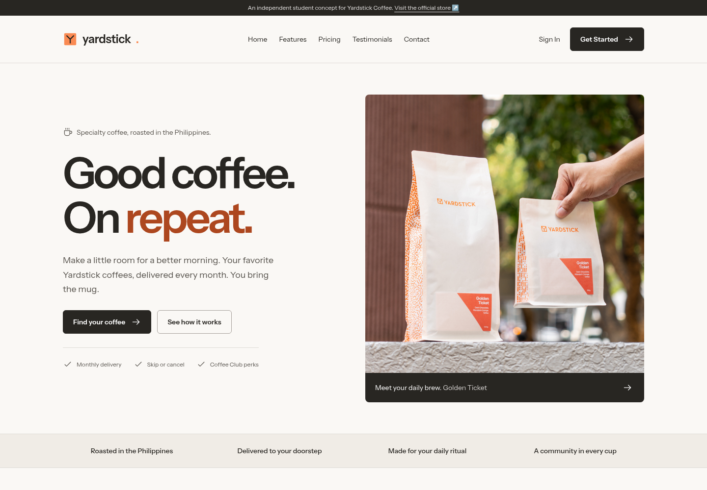
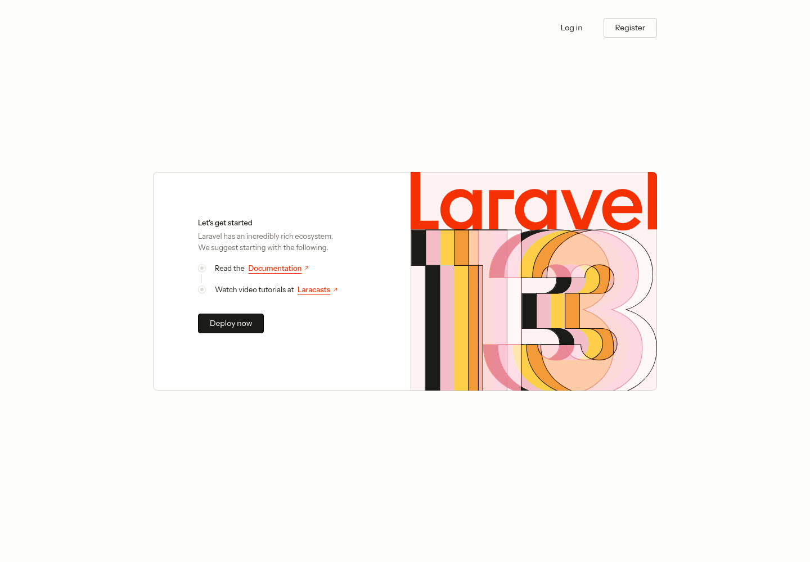

# Yardstick Coffee — Good coffee. On repeat.

ITST 302 · Week 5 · Mini Project 04: Responsive Product Landing Page

A Laravel and Tailwind CSS landing page for **Yardstick Coffee**, a real specialty coffee business in the Philippines. This is an independent student concept, not the official Yardstick website or an authorized commercial redesign.



## Introduction

A landing page introduces a business or product and helps visitors take a clear next step. Good landing pages explain the offer, answer practical questions, and make important actions easy to find on any device.

This project presents Yardstick's coffee subscriptions through an original interface: a product hero, six features, a showcase, three monthly plans, sample testimonials, FAQs, contact actions, and a footer. Calls to action lead to the relevant page or Yardstick's official store. This application does not collect payment information or create actual coffee subscriptions.

## Run locally

Requirements: PHP 8.5 for the supplied project environment, Composer, Node.js compatible with the installed Vite 8 packages, and npm. The lockfiles pin the dependencies; do not replace them with different major versions.

```sh
composer install
npm ci
```

For a fresh clone only, copy `.env.example` to `.env`, then generate a key and create the SQLite database:

```sh
cp .env.example .env
php artisan key:generate --no-interaction
php artisan migrate --no-interaction
npm run build
php artisan serve --no-interaction
```

Open the address printed by Artisan. In this workspace, it is `http://localhost:8000`. For live frontend updates, run `npm run dev` in a second terminal. The included starter account and team dashboard pages remain available; the landing page's account links intentionally go to Yardstick's official store.

Do not copy over an existing `.env` or regenerate an existing application key. No landing-page migration or seeding is necessary. The landing page's content is stored in `config/landing.php`.

## Objectives

- Build a complete landing page for a researched, real Philippine business.
- Reuse Blade components for common UI patterns.
- Apply mobile-first Tailwind layouts with Grid, Flexbox, and responsive breakpoints.
- Maintain consistent typography, spacing, colors, and accessible interaction states.
- Verify the public response, escaped content, existing dashboard, and responsive browser layouts.
- Document design decisions, assets, sources, and the before-and-after comparison.

## Responsive web design

The page starts with a single-column mobile layout. `sm:` adds feature columns and room for secondary preview content, `md:` introduces the split hero and testimonial columns, and `lg:` enables the full navigation and three-column pricing grid. The central content container is capped at 1280px with responsive side padding.

| Viewport | Layout behavior | Evidence |
| --- | --- | --- |
| 320px phone | Compact navigation and stacked content; no horizontal overflow | [Small mobile](screenshots/small-mobile.png) |
| 390px phone | Touch-friendly menu and vertically arranged plans | [Mobile](screenshots/mobile.png) |
| 768px tablet | Split hero, two-column features, compact menu | [Tablet](screenshots/tablet.png) |
| 1024px laptop | Navigation adapts to available content width | [Laptop](screenshots/laptop.png) |
| 1440px desktop | Full navigation, three-column features and pricing | [Desktop](screenshots/desktop.png) |

Grid handles repeated cards and section columns; Flexbox aligns navigation, calls to action, and icon/text rows. All photographs have intrinsic dimensions, descriptive alternative text, and responsive sizing. Below-the-fold images use lazy loading.

UX and accessibility choices include a skip link, semantic landmarks, one main heading, clear link labels, visible keyboard focus, readable contrast, native disclosure controls, and reduced-motion support. The mobile menu works without JavaScript; JavaScript adds closing after selection, outside clicks, and Escape. FAQ disclosures remain functional without JavaScript.

## Tailwind CSS

The installed project uses Tailwind 4.3.3 with CSS-first theme tokens. Utility classes express styling directly on the component, keeping layout changes near the markup they affect. The shared `page-width` class standardizes the content width and horizontal gutters.

```blade
<div class="grid gap-x-10 gap-y-10 sm:grid-cols-2 lg:grid-cols-3">
    {{-- Repeated feature components --}}
</div>
```

Unprefixed utilities apply at every width. `sm:grid-cols-2` starts at 640px and `lg:grid-cols-3` starts at 1024px, subject to available browser content width. Flexbox utilities such as `flex`, `items-center`, and `gap-3` keep buttons and icons aligned. `hover:` and `focus-visible` provide interaction feedback. Borders, modest rounded corners, and subtle shadows distinguish interactive elements and previews.

The landing page intentionally uses a consistent light theme. Its styles are scoped through `.landing` and dedicated color names so the starter's existing dark-mode account interface keeps its own appearance.

## Blade components

Anonymous Blade components separate repeated UI from page composition. Props define the data each component accepts; the attribute bag allows callers to add classes and accessible labels. Blade's escaped output protects editable copy from being interpreted as HTML.

| Component | Responsibility |
| --- | --- |
| `navbar.blade.php` | Branding, desktop navigation, and mobile disclosure menu |
| `hero.blade.php` | Product introduction, primary image, and two calls to action |
| `feature-card.blade.php` | Reusable icon, title, and description |
| `pricing-card.blade.php` | Plan name, price, quantity, included features, and subscription link |
| `testimonial-card.blade.php` | Labeled sample review, portrait, name, and role |
| `button.blade.php` | Consistent link-based primary, secondary, and accent actions |
| `footer.blade.php` | Company information, links, social icons, contact, and copyright |
| `landing-icon.blade.php` | Small inline SVG icons without an additional dependency |

```blade
<x-feature-card
    icon="truck"
    title="One less thing to remember"
    description="A monthly delivery keeps your coffee routine going."
/>

<x-button href="#pricing" variant="primary">
    Find your coffee <x-landing-icon />
</x-button>
```

The page extends `layouts/app.blade.php` with `@extends` and supplies `@section('content')`. That layout also preserves the starter's existing `$slot` rendering path for authenticated pages. The landing-page route uses the named `home` route, and local home links use `route('home')`.

Adding a feature, plan, FAQ, or sample review only requires changing the corresponding array in `config/landing.php`. The component markup stays shared. After editing configuration in a cached deployment, rebuild the configuration cache.

## User interface design

The design uses product photography, clear type, and a warm neutral background. The orange accent echoes the color visible on Yardstick packaging; the wordmark and small Y symbol are an original concept treatment, not a claim to be the official logo. The frontend design skill guided restrained borders, consistent spacing, and simple interactions.

| Token | Color | Use |
| --- | --- | --- |
| Paper | `#faf8f5` | Main background |
| Ink | `#282622` | Main text and dark sections |
| Line | `#dedbd5` | Subtle separators |
| Coffee orange | `#fa8a52` | Accent controls with dark text |
| Rust | `#ad471f` | Accent text and focus outlines |

Typography uses the starter's locally built Instrument Sans font, with 400, 500, and 600 weights. Headings have a clear scale, while body copy uses comfortable line spacing. Icons share a simple outline treatment. The featured Legazpi card uses a dark surface to create emphasis without claiming it is the most popular plan.

## Folder structure

```text
app/                              Existing Laravel application and account logic
config/
  landing.php                     Features, plans, sample reviews, and FAQs
resources/
  css/app.css                     Tailwind theme and scoped landing styles
  js/app.js                       Mobile navigation enhancements
  views/
    layouts/app.blade.php          Shared layout and starter slot compatibility
    components/                   Reusable Blade components
    pages/landing.blade.php        Landing-page section composition
public/
  images/                         Locally served photographs and concept mark
  build/                          Generated production assets (gitignored)
routes/web.php                    Named public homepage route
tests/Feature/LandingPageTest.php  Public content, destination, and escaping tests
screenshots/                      Responsive and section captures
documentation/                    Sources, comparison, capture tool, submission draft
README.md                         Project documentation
```

The existing authentication and team code is retained from the starter. No new backend dependencies or tables were added.

## Screenshots and before-and-after

The **before** image captures the original Laravel starter homepage before implementation. The **after** image captures the completed landing-page hero at the same 1440px desktop viewport. Full-page and section captures document the complete interface.

| Before | After |
| --- | --- |
|  |  |

The redesign replaces framework onboarding content with a business-specific offer, original section hierarchy, product photography, reusable cards, clear calls to action, and responsive navigation. [Design comparison](documentation/design-comparison.md) explains the changes.

| Screenshot | File |
| --- | --- |
| Navigation | [Navbar](screenshots/navbar.png) |
| Hero | [Hero](screenshots/hero.png) |
| Six features | [Features](screenshots/features.png) |
| Product, desktop dashboard, and mobile preview | [Showcase](screenshots/showcase.png) |
| Three pricing plans | [Pricing](screenshots/pricing.png) |
| Sample testimonials | [Testimonials](screenshots/testimonials.png) |
| Contact call to action | [Contact](screenshots/contact.png) |
| Footer | [Footer](screenshots/footer.png) |

The VS Code project-tree screenshot, Blade-components-folder screenshot, and public GitHub-repository screenshot must be captured from the student's own editor and published repository before submission. They have not been fabricated.

## Verification

```sh
npm run build
php artisan test --compact tests/Feature/LandingPageTest.php tests/Feature/ExampleTest.php tests/Feature/DashboardTest.php
vendor/bin/pint --dirty --format agent
```

The affected test run passes **6 tests and 17 assertions**. It checks the public section sequence, plan prices, real business destinations, clear concept disclosures, escaped editable testimonials, and existing dashboard behavior. Build first, then run these tests: rendering uses the Vite manifest, which is briefly replaced during a build.

The production build passes. Vite prints an existing optional font-fallback optimization notice because `fontaine` is not installed; font files still build and load, and no dependency was added.

Browser checks at 320, 390, 768, 1024, and 1440px confirm no horizontal overflow, no broken images, functioning mobile navigation and FAQ disclosures, valid internal section targets, and no JavaScript exceptions during the capture run. Screenshots were captured in headless Chromium and visually reviewed at desktop and mobile sizes. Run the full project suite before submission:

```sh
php artisan test --compact
```

For reproducible screenshot export, launch a temporary headless Chromium session with a fresh profile and local remote debugging on port 9223, run the local app on port 8000, then execute `node documentation/capture.mjs`. The script uses Node's built-in WebSocket support and the browser's DevTools protocol; it does not install a browser-test package. It overwrites the final screenshot files. `--before` is only meaningful before replacing the starter page.

## Problems, solutions, and reflection

- **A generic software rubric applied to a coffee business:** use three real coffee plans and a clearly labeled subscription-dashboard concept. Registration and Contact Sales satisfy the final call-to-action requirement; no unsupported free trial is advertised.
- **Testimonials without verified customer consent:** use conspicuously labeled fictional personas and stock portraits. Replace them with permissioned, verified testimonials before any real business deployment.
- **Existing application layout:** support template inheritance for the public page while preserving the starter component slot for account pages. Dashboard regression tests confirm the existing path still renders.
- **Different screen widths:** apply mobile-first grids and native disclosure navigation, then inspect screenshots and overflow measurements across five widths.
- **Build/test ordering:** a test initially encountered the Vite manifest while the build was replacing it. Running the completed build before the test suite resolved the issue.

The project demonstrates how a small set of explicit component interfaces can support a complete page. It also shows why content provenance matters: real prices and products can be researched, while illustrative account screens and reviews must stay clearly distinguished from live business services. Add your own learning reflection before submitting.

## Sources and submission

Business facts, product links, asset origins, and reuse notes are recorded in [Sources](documentation/sources.md). Prices are a September 8, 2026 reference snapshot; the official checkout is authoritative.

See [Submission checklist and LinkedIn draft](documentation/submission.md) for the remaining personal publication steps. The required public repository name is `week05-product-landing-page`. Publishing to GitHub, LinkedIn, and the LMS is not performed by the landing page or screenshot tool.

The implementation is recorded in ten meaningful local commits covering content, components, navigation, page assembly, tests, screenshots, and documentation, in addition to the supplied initial commit. No remote repository is configured yet.
