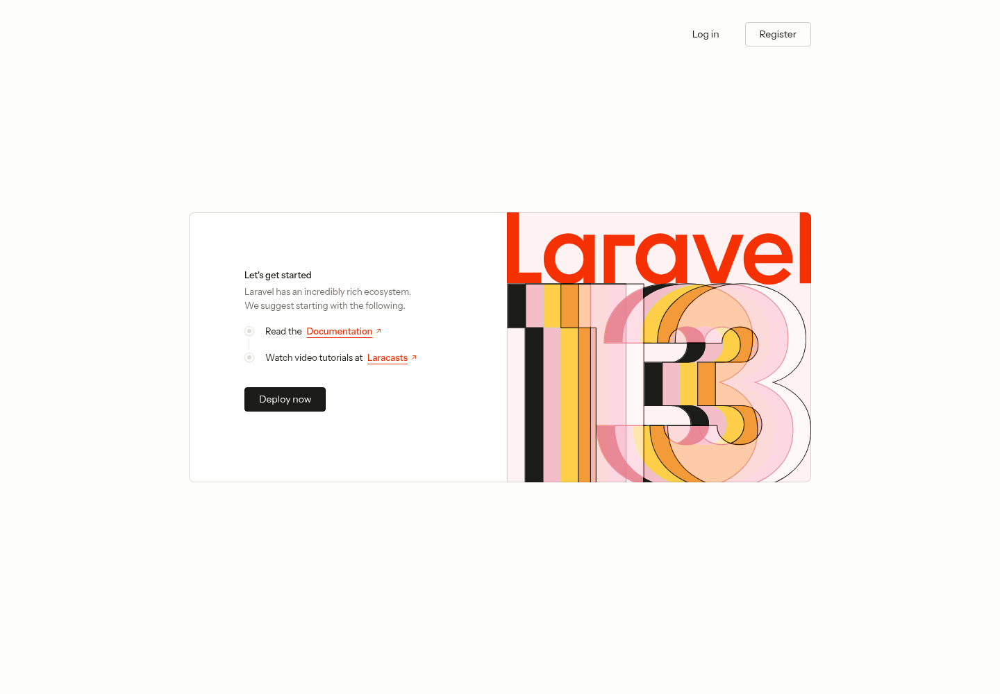
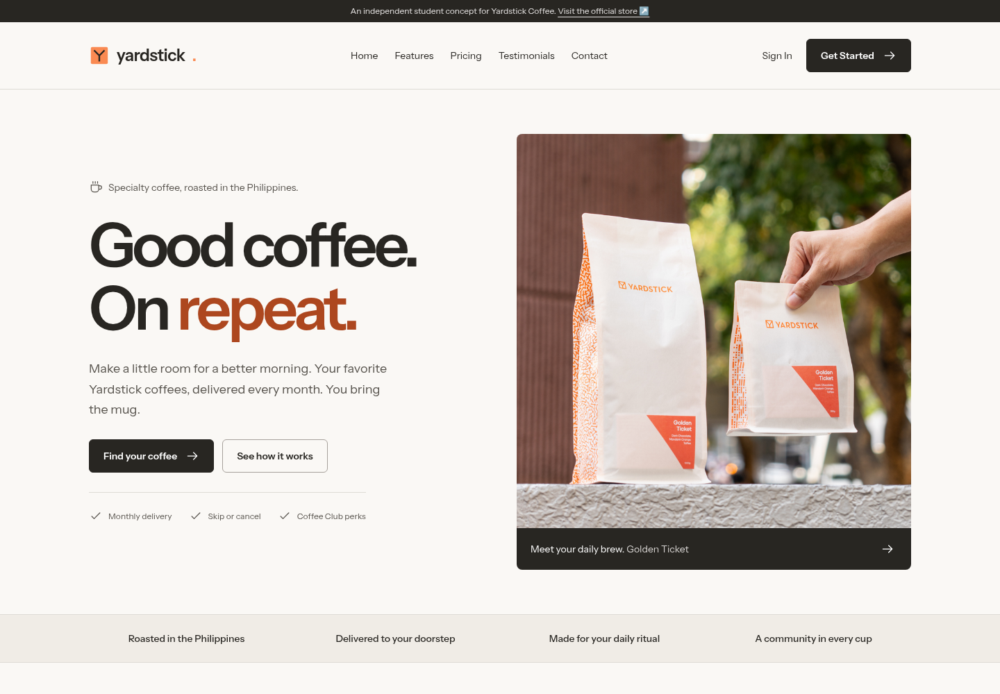

# Before and after

## Before: supplied Laravel starter

The original homepage introduced the Laravel framework and linked to developer resources. It had no coffee-business content, subscription comparison, customer-story section, or business contact calls to action.

## After: Yardstick landing-page concept

The new hero introduces the business with a real product image and two next steps. Repeated feature, pricing, and testimonial components create consistent visual patterns through the rest of the page. A paper background, dark text, and packaging-inspired orange establish a coherent visual identity.

The desktop layout uses clear section boundaries and a readable content width. On small screens, the menu becomes a native disclosure and the content stacks in reading order. Touch controls, keyboard focus, image descriptions, and reduced-motion handling improve usability.

The concept dashboard illustrates desktop and mobile account layouts without implying there is a live coffee account in the local application. Fictional testimonials are labeled alongside the cards. Subscription and registration actions lead to the official business website.

Both comparison images use a 1440px desktop viewport. See the [full desktop capture](../screenshots/desktop.png) and [mobile capture](../screenshots/mobile.png) for the complete page.
